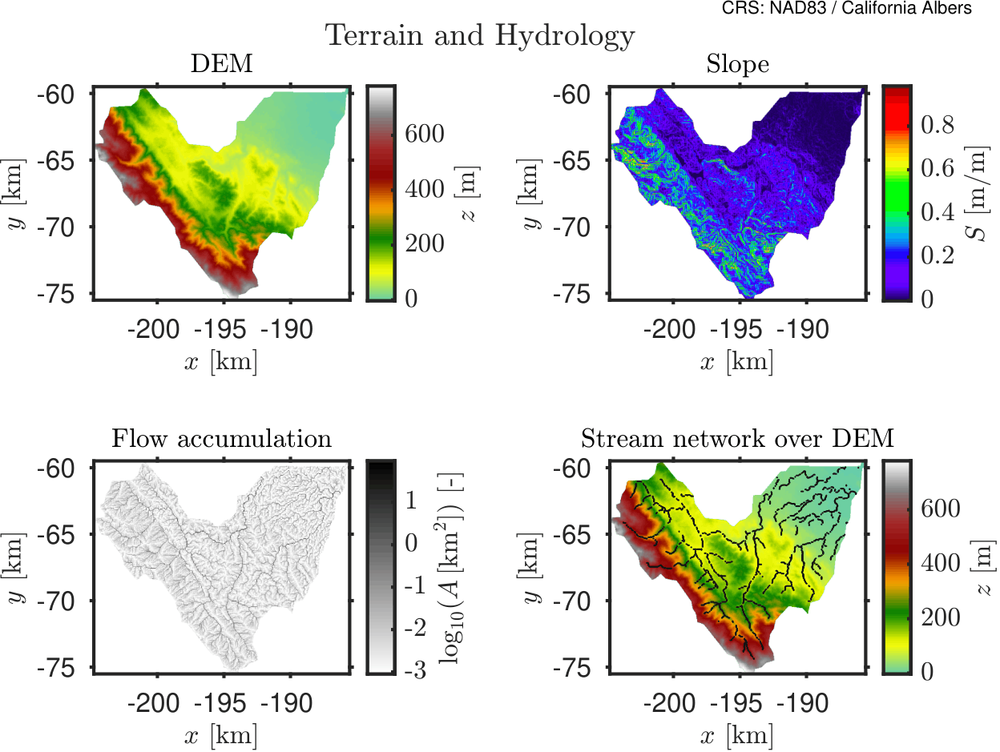

import useBaseUrl from '@docusaurus/useBaseUrl';

# San Francisquito Catchment - Controlled Rainfall Example

## Purpose

This example presents a controlled rainfall-runoff simulation for the San Francisquito catchment near Stanford, California. It shows how HydroPol2D is configured for a realistic watershed domain under a prescribed storm.

## Case setup

The case `Stanford_30m_100mmh_1h_24h` uses:

| Item | Value |
|---|---|
| Domain | San Francisquito sub-catchment, California, USA |
| Grid resolution | 30 m |
| Forcing type | Spatially invariant rainfall |
| Rainfall event | 100 mm/h for 1 hour |
| Simulation duration | 24 h |
| Map output interval | 15 min |
| Routing family | Local inertial |
| Outlet treatment | Perimeter outlet |

## Input data

The static inputs were prepared from a Google Earth Engine workflow and aligned to a 30 m grid over the catchment. The main layers used in the current example are:

- DEM;
- land use and land cover;
- soil texture;
- depth to bedrock or soil depth.

The simulation uses the current HydroPol2D layered soil and vadose formulation. Parameter values come from the Stanford configuration distributed with the model.

## What this case is meant to show

This case highlights:

- runoff generation under a simple, known forcing;
- the interaction between topography, roughness, and infiltration;
- the spatial organization of routed flood depth, velocity, hazard, and cumulative infiltration;
- long recession behavior after the rainfall pulse ends.

## Input maps

### Figure 1 - Terrain and drainage

### Figure 2 - Surface properties

### Figure 3A - Soil hydraulic properties

### Figure 3B - Soil retention and storage

## Simulation video

The animation below shows the 30 m simulation. The panels show flood depth, velocity, hazard metric, and cumulative infiltration.

  <video
    width="90%"
    controls
    poster={useBaseUrl('/videos/stanford_30m_website_100mmh_1h_24h_panels.png')}>
    <source src={useBaseUrl('/videos/stanford_30m_website_100mmh_1h_24h_panels.mp4')} type="video/mp4" />
    Your browser does not support the video tag.
  </video>

  
<em>Stanford 30 m controlled rainfall simulation: flood depth, velocity, hazard, and cumulative infiltration.</em>

Each panel uses one color scale for the full sequence. The scale is based on the `99th` percentile of all saved frames.

## Summary results

The simulation produced `97` saved map frames. Summary metrics are:

- a drainage area of `156.823 km²`;
- a run-total rainfall depth of `100 mm`;
- a maximum flood depth of `0.64 m`;
- a peak outlet flow of `335.03 m³/s`;
- preprocessing figures for terrain, surface properties, and soil properties.
