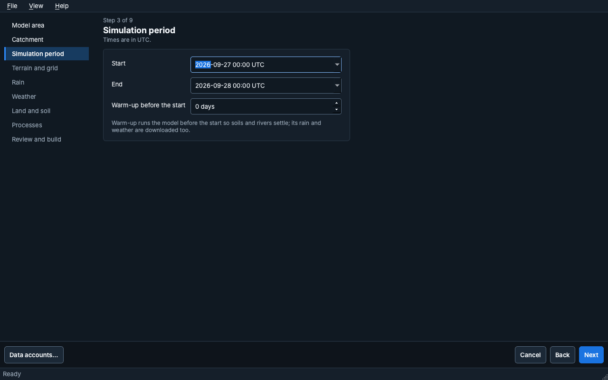
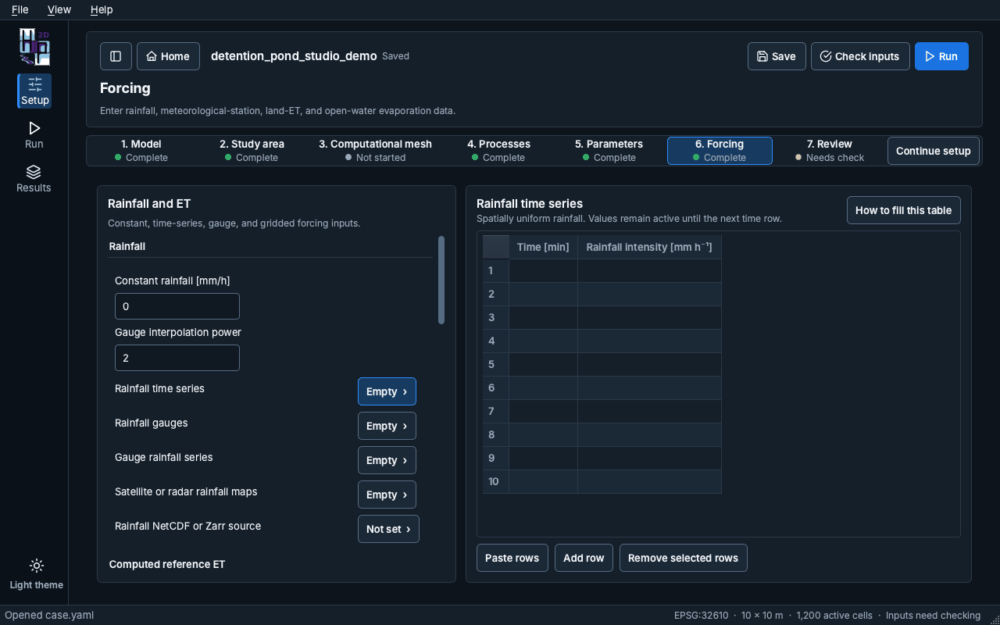
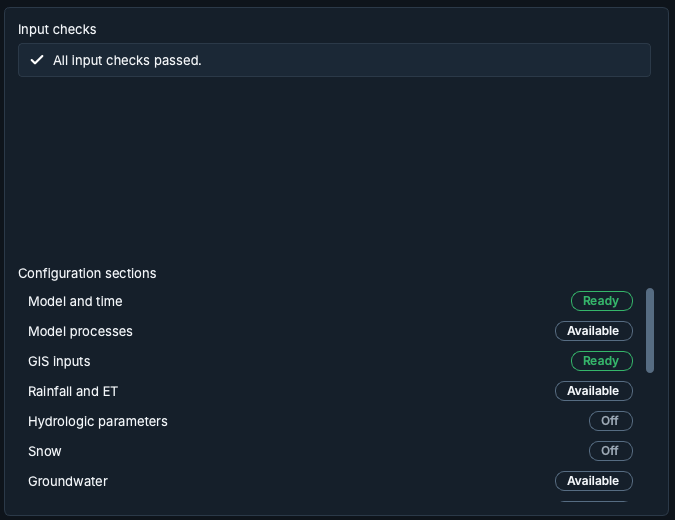

# Building a model

## New model wizard

**New model** on Home opens the wizard. Each page shows "Step N of M", its title and a short note,
and the step list on the left marks the current step and the ones done. **Back**, **Next** and
**Cancel** move through it; **Data accounts…** stores the logins some data sources need.

1. **Model area**: how to define the area of the model.
   - *A city or town*: type its name; the model covers the city and the land that drains into it.
   - *A river outlet I click on the map*: the model covers everything upstream of the point.
   - *An area file I already have*: a polygon file.
   - *My own terrain file and an outlet*: your DEM and a clicked outlet.

   The page also asks for the model name and the folder to save it in.
2. **Catchment** (only for the two outlet choices): prepare the terrain, click a river to place the
   outlet, and check the catchment.
3. **Simulation period**: start, end and an optional warm-up, in UTC. Warm-up runs the model before
   the start so soils and rivers settle; its rain and weather are downloaded too.
4. **Terrain and grid**, 5. **Rain**, 6. **Weather**, 7. **Land and soil** and 8. **Processes**:
   the data sources and the processes to simulate.
9. **Review and build**: a summary of the choices. **Preview the area** draws the area on the map;
   **Build model** downloads the data and builds the model. **Open model** opens it when the build is
   done.

## Setup steps

Setup is guided but not locked: **Continue setup** opens the next recommended step, and every step
can be chosen from the step bar. Each step shows its status (Complete, Not started, Needs check).

1. **Model**: name, description, simulation period and the model file. A long path is shortened
   in the middle; **Show in Finder** (Explorer on Windows) opens its folder, and a right-click
   copies the whole path.
2. **Study area**: the DEM, the computational domain, model input rasters, terrain processing,
   boundaries, facilities, urban drainage, road and river crossings, and the cell inspector. The
   tool rail on the left opens each of these; the map shows the selected raster over a basemap.
3. **Computational mesh**: a regular grid, an automatic Voronoi mesh, or an imported mesh package.
   The mesh editor has its own **Apply edits** and **Discard edits**.
4. **Processes**: under **Model processes**, the processes to simulate, the surface routing solver
   and its time stepping (minimum and maximum time step, Courant number). **Routing** holds the
   advanced numerical settings, folded by default: the roughness fallback, the wet and dry depth,
   solver options, subgrid tables and boundary numerics.
5. **Parameters**: process parameters, the land-cover and soil tables, green-infrastructure
   designs, and urban-drainage design and solver values.
6. **Forcing**: rainfall, reference and land evapotranspiration, open-water evaporation and
   gridded meteorology (see below).
7. **Review**: the model summary, the input checks and the status of each configuration section
   (see below).

### Forcing

The Forcing page has two panes. On the left, each group starts with its single values (for example
**Constant rainfall** and **Gauge interpolation power**), then lists its tables with how full they
are ("Empty", "3 rows", "Not set"). Choose a table to edit it on the right; the table on screen is
outlined.

Time-series tables open with ten rows. They accept tab-separated blocks pasted from Excel and grow
when the pasted block is longer. **How to fill this table** explains each column. Rainfall comes
from one source: filling a rainfall table turns the other rainfall inputs off.

### Review

**Input checks** lists what the last check found. Each check has a severity icon and an **Open**
button that goes to the setting it is about; after a check with no issues the list says "All input
checks passed." Before the first check, the list says so; **Check inputs** is in the header.

**Configuration sections** shows each section with a status chip (Ready, Needs input, Available or
Off). A click opens the section.

