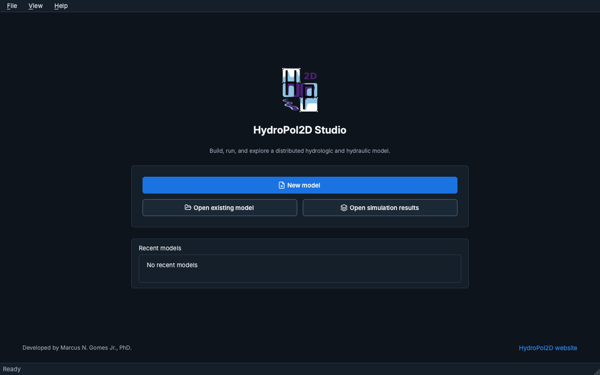

# HydroPol2D Studio

HydroPol2D Studio is the desktop interface for HydroPol2D-Python. It builds a model from a map or
from your own files, sets it up step by step, runs it, and shows the results. Studio is a separate
layer around the model engine: it does not call MATLAB and does not duplicate the solver.

This section describes Studio 0.9 (release candidate).

## Install and start

Studio runs with a license code from Marcus N. Gomes Jr. [Install and license](install-and-license)
explains how to ask for one, install Studio on a Mac or on Windows, and activate it.

The installed app opens like any other program.

## Home

Studio opens on **Home**, with three choices:

- **New model** opens the [New model wizard](building-a-model#new-model-wizard), which builds a
  model from a city, a river outlet, an area file or your own terrain.
- **Open existing model** opens a `case.yaml` (or a legacy workbook).
- **Open simulation results** opens a results package without a model.

Recent models are listed below the choices.

## Workspaces

A model has three workspaces on the left rail:

| Workspace | What it is for |
|---|---|
| **Setup** | Seven steps: Model, Study area, Computational mesh, Processes, Parameters, Forcing and Review. |
| **Run** | Output products, the input check, the computing backend and the run itself, with live diagnostics. |
| **Results** | Maps and time series of a finished run, with playback, profiles and exports. |

Cmd+1, Cmd+2 and Cmd+3 open them on a Mac (Ctrl+1 to Ctrl+3 on Windows).

## In this section

- [Install and license](install-and-license): asking for a license, installing and activating.
- [Building a model](building-a-model): the New model wizard and the seven Setup steps.
- [Working in Studio](working-in-studio): how edits, Save and Revert to saved work, error messages,
  themes, menus and shortcuts.
- [Run and results](run-and-results): running a model and reading its results.
