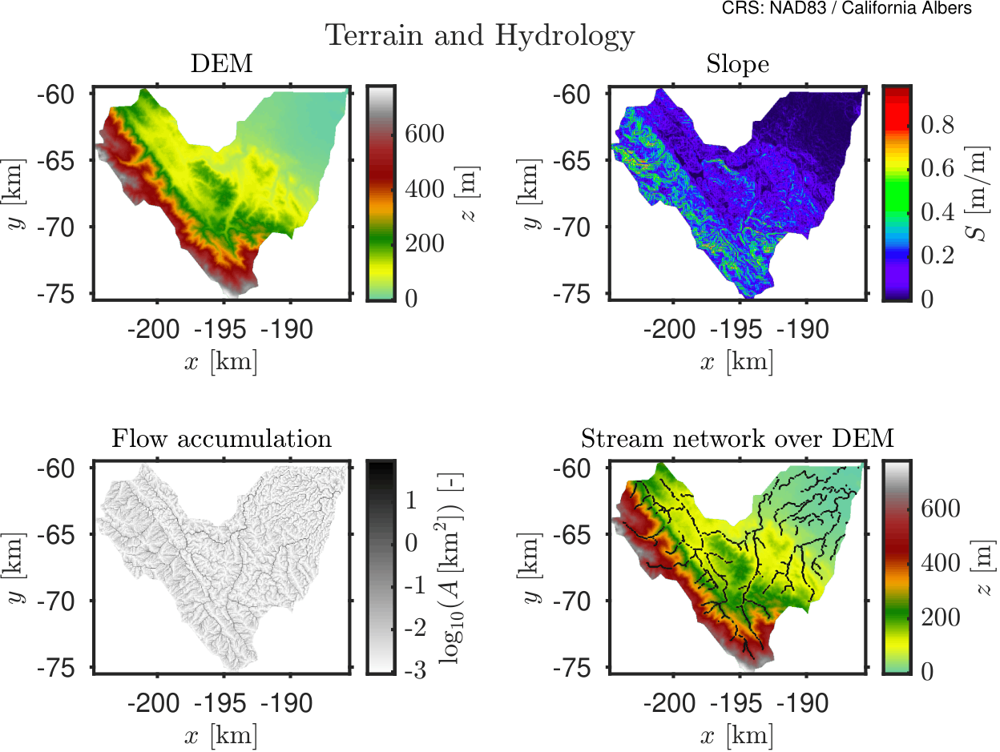

import useBaseUrl from '@docusaurus/useBaseUrl';

# Cuenca de San Francisquito - Ejemplo de Lluvia Controlada

## Objetivo

Este ejemplo presenta una simulación controlada de lluvia y escorrentía para la cuenca San Francisquito, cerca de Stanford, California. Muestra cómo se configura HydroPol2D para un dominio realista de cuenca bajo una tormenta prescrita.

## Configuración del caso

El caso `Stanford_30m_100mmh_1h_24h` utiliza:
| Ítem | Valor |
|---|---|
| Dominio | Subcuenca San Francisquito, California, EE.UU. |
| Resolución de cuadrícula | 30 m |
| Tipo de forzado | Precipitación espacialmente invariante |
| Evento de lluvia | 100 mm/h durante 1 hora |
| Duración de la simulación | 24 h |
| Intervalo de salida del mapa | 15 min |
| Familia de enrutamiento | Inercial local |
| Tratamiento de salida | Salida por el perímetro |
## Datos de entrada

Las entradas estáticas se prepararon a partir de un flujo de trabajo Google Earth Engine y se alinearon con una cuadrícula 30 m sobre la cuenca. Las principales capas utilizadas en el ejemplo actual son:
- DEM;
- uso y cobertura del suelo;
- textura del suelo;
- profundidad hasta el lecho de roca o la profundidad del suelo.

La simulación utiliza la formulación actual de suelo en capas y zona vadosa de HydroPol2D. Los valores de los parámetros provienen de la configuración Stanford distribuida con el modelo.
## Lo que este caso pretende mostrar

Este caso destaca:
- generación de escorrentía bajo un forzamiento simple y conocido;
- la interacción entre topografía, rugosidad e infiltración;
- la organización espacial de la profundidad, velocidad, peligro e infiltración acumulativa de la inundación enrutada;
- comportamiento de recesión prolongada después de que termina el pulso de lluvia.
## Mapas de entrada

### Figura 1 - Terreno y drenaje

### Figura 2 - Propiedades de la superficie

### Figura 3A - Propiedades hidráulicas del suelo

### Figura 3B - Retención y almacenamiento del suelo

## Vídeo de simulación

La siguiente animación muestra la simulación a 30 m. Los paneles presentan la profundidad de la inundación, la velocidad, la métrica de peligro y la infiltración acumulativa.

  <video
    width="90%"
    controls
    poster={useBaseUrl('/videos/stanford_30m_website_100mmh_1h_24h_panels.png')}>
    <source src={useBaseUrl('/videos/stanford_30m_website_100mmh_1h_24h_panels.mp4')} type="video/mp4" />
    Su navegador no soporta la etiqueta de video.
  </video>

<em>Simulación controlada de lluvia en Stanford, 30 m: profundidad de inundación, velocidad, peligro e infiltración acumulativa.</em>

Cada panel usa una sola escala de color para toda la secuencia. La escala se basa en el percentil `99th` de todos los fotogramas guardados.
## Resultados resumidos

La simulación produjo `97` fotogramas de mapa guardados. Las métricas principales son:

- un área de drenaje de `156.823 km²`;
- una lluvia total de `100 mm`;
- una profundidad máxima de inundación de `0.64 m`;
- un caudal máximo de salida de `335.03 m³/s`;
- figuras de preprocesamiento para el terreno, las propiedades de la superficie y las propiedades del suelo.
