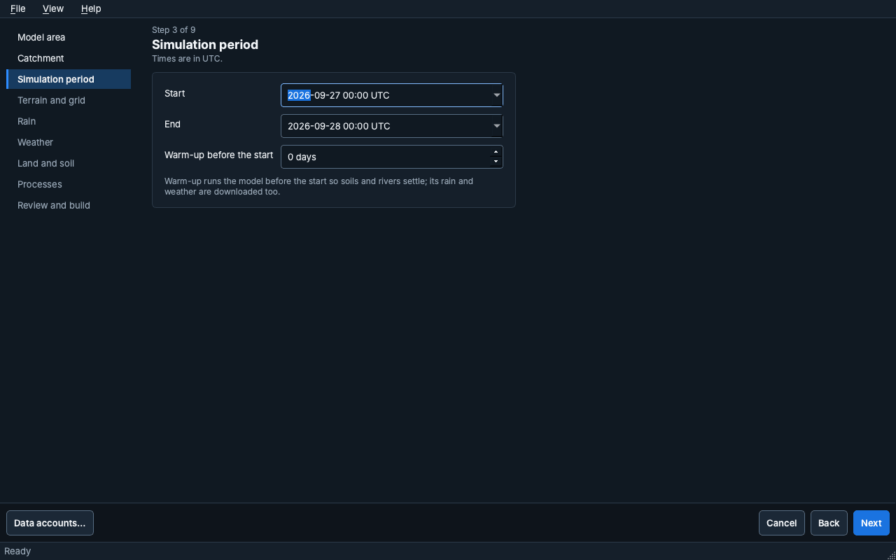
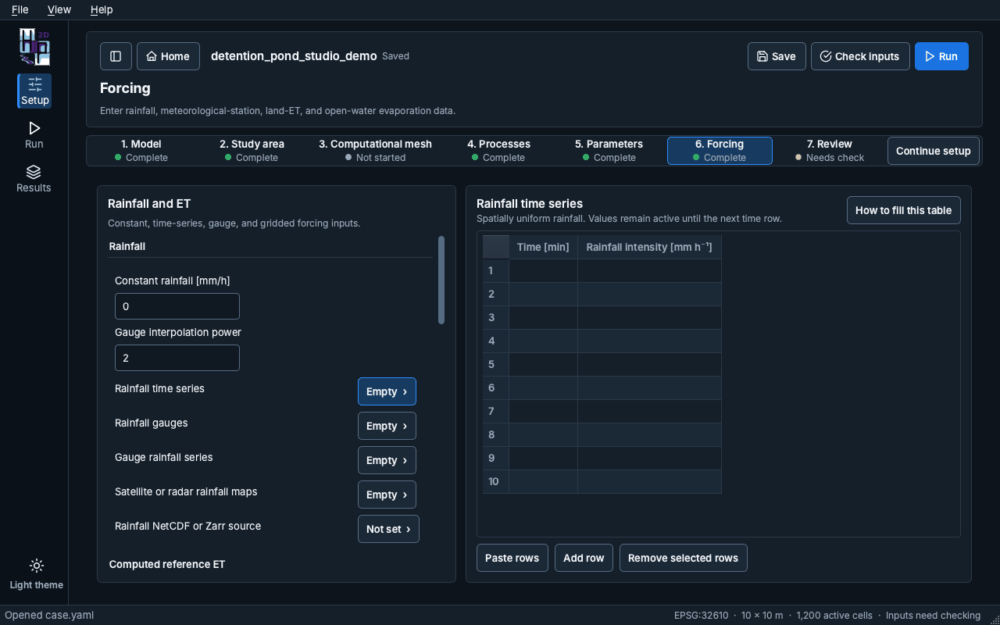
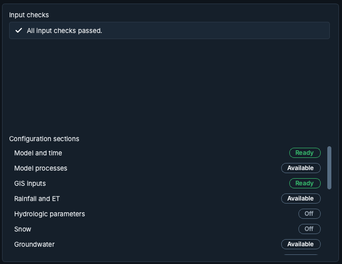

# Construir un modelo

## Asistente de nuevo modelo {#new-model-wizard}

**New model**, en la pantalla Home, abre el asistente. Cada página muestra "Step N of M", su título y
una nota breve, y la lista de pasos de la izquierda marca el paso actual y los ya completados.
**Back**, **Next** y **Cancel** permiten moverse por el asistente. **Data accounts…** guarda los
inicios de sesión que piden algunas fuentes de datos.

1. **Model area**: cómo definir el área del modelo.
   - *A city or town*: escriba su nombre; el modelo cubre la ciudad y el terreno que drena hacia ella.
   - *A river outlet I click on the map*: el modelo cubre todo lo que está aguas arriba del punto.
   - *An area file I already have*: un archivo de polígono.
   - *My own terrain file and an outlet*: su DEM y un punto de salida marcado en el mapa.

   La página también pide el nombre del modelo y la carpeta donde guardarlo.
2. **Catchment** (solo para las dos opciones con punto de salida): prepare el terreno, haga clic en
   un río para colocar el punto de salida y revise la cuenca.
3. **Simulation period**: inicio, fin y un calentamiento (warm-up) opcional, en UTC. El calentamiento
   ejecuta el modelo antes del inicio para que los suelos y los ríos se estabilicen; la lluvia y los
   datos meteorológicos de ese periodo también se descargan.
4. **Terrain and grid**, 5. **Rain**, 6. **Weather**, 7. **Land and soil** y 8. **Processes**:
   las fuentes de datos y los procesos que se van a simular.
9. **Review and build**: un resumen de las elecciones. **Preview the area** dibuja el área en el
   mapa; **Build model** descarga los datos y construye el modelo. **Open model** lo abre cuando
   termina la construcción.

## Pasos de Setup {#setup-steps}

Setup es guiado, pero no bloqueado: **Continue setup** abre el siguiente paso recomendado, y
cualquier paso se puede elegir en la barra de pasos. Cada paso muestra su estado (Complete,
Not started, Needs check).

1. **Model**: nombre, descripción, periodo de simulación y archivo del modelo. Una ruta larga se
   acorta en el medio; **Show in Finder** (Explorer en Windows) abre su carpeta, y un clic derecho
   copia la ruta completa.
2. **Study area**: el DEM, el dominio computacional, los rásteres de entrada del modelo, el
   procesamiento del terreno, las condiciones de contorno, las estructuras de detención y de
   infraestructura verde, el drenaje urbano, los cruces de caminos sobre ríos (alcantarillas y
   puentes) y el inspector de celdas. La barra de herramientas de la izquierda abre cada uno de
   ellos; el mapa muestra el ráster seleccionado sobre un mapa base.
3. **Computational mesh**: una malla regular, una malla de Voronoi automática o un paquete de malla
   importado. El editor de malla tiene sus propios **Apply edits** y **Discard edits**.
4. **Processes**: en **Model processes**, los procesos que se van a simular, el solver de
   enrutamiento superficial y el control del paso de tiempo (paso de tiempo mínimo y máximo, número
   de Courant). **Routing** reúne los ajustes numéricos avanzados, plegados por defecto: la
   rugosidad por defecto (usada cuando falta un valor), la profundidad de mojado y secado, las
   opciones del solver, las tablas subgrid y el tratamiento numérico de los contornos.
5. **Parameters**: los parámetros de los procesos, las tablas de cobertura del suelo y de suelos, los
   diseños de infraestructura verde y los valores de diseño y del solver del drenaje urbano.
6. **Forcing**: lluvia, evapotranspiración de referencia y de la superficie terrestre, evaporación de
   aguas abiertas y meteorología en malla (ver más abajo).
7. **Review**: el resumen del modelo, las verificaciones de entrada y el estado de cada sección de
   configuración (ver más abajo).

### Forcing {#forcing}

La página Forcing tiene dos paneles. A la izquierda, cada grupo empieza con sus valores únicos (por
ejemplo **Constant rainfall** y **Gauge interpolation power**) y luego lista sus tablas indicando
cuánto contiene cada una ("Empty", "3 rows", "Not set"). Elija una tabla para editarla a la derecha; la
tabla que está en pantalla queda resaltada con un contorno.

Las tablas de series temporales se abren con diez filas. Aceptan bloques separados por tabulaciones
pegados desde Excel y crecen cuando el bloque pegado es más largo. **How to fill this table** explica
cada columna. La lluvia viene de una sola fuente: llenar una tabla de lluvia desactiva las demás
entradas de lluvia.

### Review {#review}

**Input checks** lista lo que encontró la última verificación. Cada elemento tiene un icono de
gravedad y un botón **Open** que lleva al ajuste al que se refiere; tras una verificación sin
problemas, la lista dice "All input checks passed." Antes de la primera verificación, la lista
indica que aún no se ha hecho; **Check inputs** está en el encabezado.

**Configuration sections** muestra cada sección con una etiqueta de estado (Ready, Needs input,
Off o Available). Un clic abre la sección.

