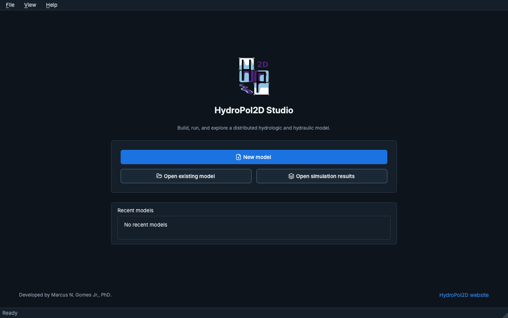

# HydroPol2D Studio

HydroPol2D Studio es la interfaz de escritorio de HydroPol2D-Python. Construye un modelo a partir de
un mapa o de sus propios archivos, lo configura paso a paso, lo ejecuta y muestra los resultados.
Studio es una capa separada alrededor del motor del modelo: no llama a MATLAB ni duplica el
solver.

Esta sección describe Studio 0.9 (release candidate). La interfaz de Studio está en inglés, por lo
que los nombres de botones, menús y mensajes aparecen aquí en inglés, tal como se ven en pantalla.

## Instalar e iniciar {#install-and-start}

Studio funciona con un código de licencia de Marcus N. Gomes Jr. La página
[Instalación y licencia](install-and-license) explica cómo solicitar un código, instalar Studio en
Mac o en Windows y activarlo.

La app instalada se abre como cualquier otro programa.

## Home {#home}

Studio se abre en la pantalla **Home**, con tres opciones:

- **New model** abre el [asistente de nuevo modelo](building-a-model#new-model-wizard), que
  construye un modelo a partir de una ciudad, del punto de salida de un río, de un archivo de área o
  de su propio terreno.
- **Open existing model** abre un `case.yaml` (o un libro de trabajo del formato antiguo).
- **Open simulation results** abre un paquete de resultados sin un modelo.

Los modelos recientes aparecen debajo de las opciones.

## Espacios de trabajo {#workspaces}

Un modelo tiene tres espacios de trabajo en la barra de la izquierda:

| Espacio de trabajo | Para qué sirve |
|---|---|
| **Setup** | Siete pasos: Model, Study area, Computational mesh, Processes, Parameters, Forcing y Review. |
| **Run** | Los productos de salida, la verificación de entradas, el backend de cómputo y la simulación misma, con diagnósticos en vivo. |
| **Results** | Mapas y series temporales de una simulación terminada, con reproducción, perfiles y exportaciones. |

En un Mac, Cmd+1, Cmd+2 y Cmd+3 abren cada uno (Ctrl+1 a Ctrl+3 en Windows).

## En esta sección {#in-this-section}

- [Instalación y licencia](install-and-license): cómo solicitar la licencia, instalar y activar.
- [Construir un modelo](building-a-model): el asistente de nuevo modelo y los siete pasos de Setup.
- [Trabajar en Studio](working-in-studio): cómo funcionan las ediciones, Save y Revert to saved, los
  mensajes de error, los temas, los menús y los atajos.
- [Ejecución y resultados](run-and-results): cómo ejecutar un modelo y leer sus resultados.
