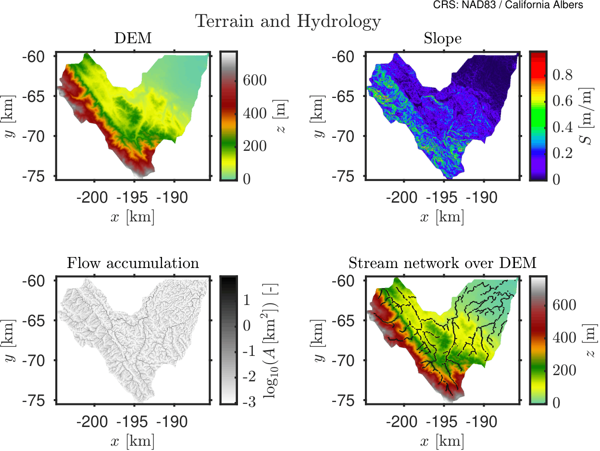

import useBaseUrl from '@docusaurus/useBaseUrl';

# Bacia Hidrográfica de San Francisquito - Exemplo de Chuva Controlada

## Propósito

Este exemplo apresenta uma simulação controlada de chuva e escoamento para a bacia hidrográfica de San Francisquito, perto de Stanford, Califórnia. Ele mostra como HydroPol2D é configurado para um domínio realista de bacia sob uma chuva prescrita.

## Configuração do caso

O caso `Stanford_30m_100mmh_1h_24h` usa:
| Item | Valor |
|---|---|
| Domínio | Sub-bacia hidrográfica San Francisquito, Califórnia, EUA |
| Resolução de grade | 30 m |
| Tipo de forçamento | Chuvas espacialmente invariantes |
| Evento de chuva | 100 mm/h por 1 hora |
| Duração da simulação | 24 h |
| Intervalo de saída do mapa | 15 min |
| Família de roteamento | Inercial local |
| Tratamento de saída | Saída pelo perímetro |
## Dados de entrada

As entradas estáticas foram preparadas a partir de um fluxo de trabalho do Google Earth Engine e alinhadas a uma grade de 30 m sobre a bacia hidrográfica. As principais camadas usadas no exemplo atual são:
- DEM;
- uso e cobertura da terra;
- textura do solo;
- profundidade até a rocha ou profundidade do solo.

A simulação usa a formulação atual de solo em camadas e zona vadosa do HydroPol2D. Os valores dos parâmetros vêm da configuração Stanford distribuída com o modelo.
## O que este caso pretende mostrar

Este caso destaca:
- geração de escoamento superficial sob um forçamento simples e conhecido;
- a interação entre topografia, rugosidade e infiltração;
- a organização espacial da profundidade, velocidade, perigo e infiltração cumulativa da inundação;
- comportamento de recessão longa após o término do pulso de chuva.
## Mapas de entrada

### Figura 1 – Terreno e drenagem

### Figura 2 - Propriedades da superfície

### Figura 3A - Propriedades hidráulicas do solo

### Figura 3B – Retenção e armazenamento do solo

## Vídeo de simulação

A animação abaixo mostra a simulação em 30 m. Os painéis mostram profundidade de inundação, velocidade, métrica de perigo e infiltração cumulativa.

  <video
    width="90%"
    controls
    poster={useBaseUrl('/videos/stanford_30m_website_100mmh_1h_24h_panels.png')}>
    <source src={useBaseUrl('/videos/stanford_30m_website_100mmh_1h_24h_panels.mp4')} type="video/mp4" />
    Seu navegador não suporta a tag de vídeo.
  </video>

<em>Simulação controlada de chuva em Stanford, 30 m: profundidade de inundação, velocidade, perigo e infiltração cumulativa.</em>

Cada painel usa uma única escala de cores para toda a sequência. A escala é baseada no percentil `99th` de todos os quadros salvos.
## Resultados resumidos

A simulação produziu `97` quadros de mapa salvos. As principais métricas são:

- uma área de drenagem de `156.823 km²`;
- uma chuva total de `100 mm`;
- uma profundidade máxima de inundação de `0.64 m`;
- uma vazão máxima de saída de `335.03 m³/s`;
- figuras de pré-processamento para terreno, propriedades de superfície e propriedades do solo.
