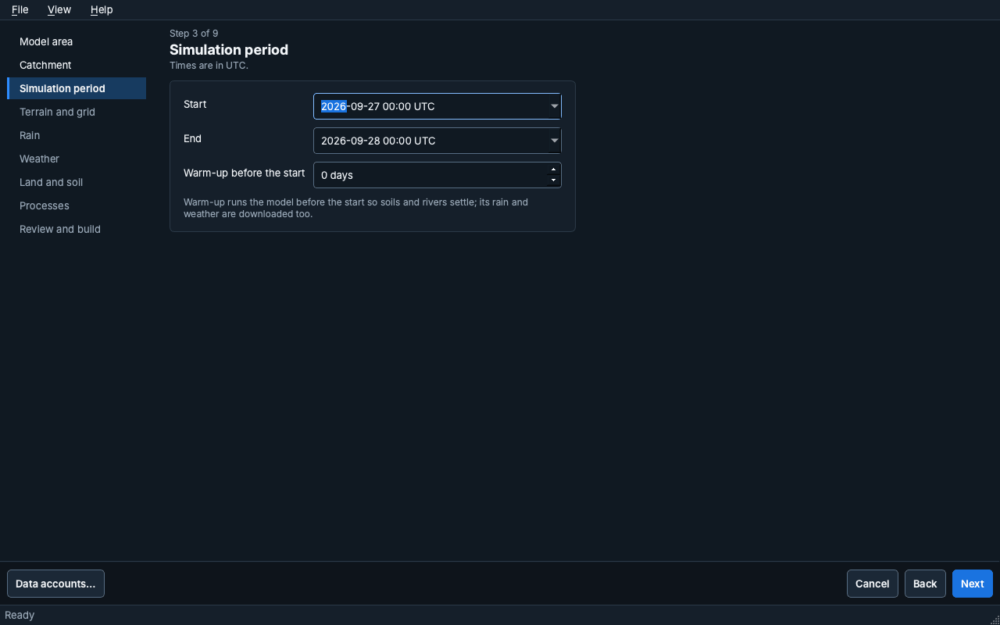
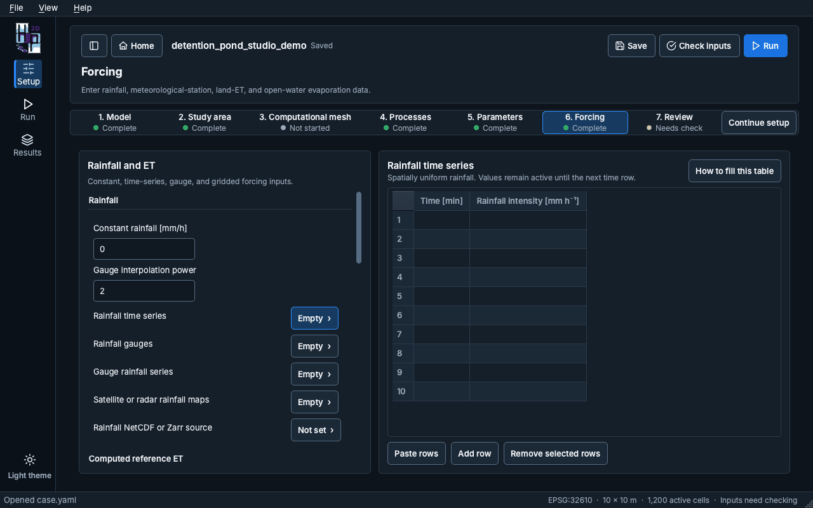
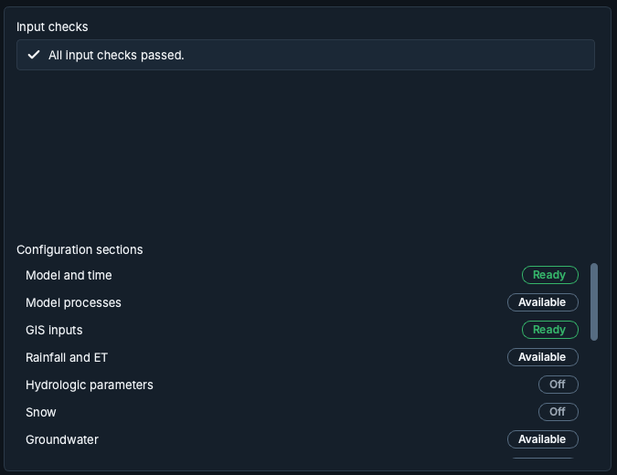

# Montando um modelo

## Assistente de novo modelo {#new-model-wizard}

**New model**, na tela Home, abre o assistente. Cada página mostra "Step N of M", o título e uma nota
curta, e a lista de etapas à esquerda marca a etapa atual e as já concluídas. **Back**, **Next** e
**Cancel** navegam pelo assistente. **Data accounts…** guarda os logins que algumas fontes de dados
exigem.

1. **Model area**: como definir a área do modelo.
   - *A city or town*: digite o nome; o modelo cobre a cidade e o terreno que drena para ela.
   - *A river outlet I click on the map*: o modelo cobre tudo o que fica a montante do ponto.
   - *An area file I already have*: um arquivo de polígono.
   - *My own terrain file and an outlet*: o seu DEM e um exutório clicado no mapa.

   A página também pede o nome do modelo e a pasta onde salvá-lo.
2. **Catchment** (só nas duas opções com exutório): prepare o terreno, clique em um rio para
   posicionar o exutório e confira a bacia.
3. **Simulation period**: início, fim e um aquecimento (warm-up) opcional, em UTC. O aquecimento
   executa o modelo antes do início para que solos e rios se estabilizem; a chuva e os dados
   meteorológicos desse período também são baixados.
4. **Terrain and grid**, 5. **Rain**, 6. **Weather**, 7. **Land and soil** e 8. **Processes**:
   as fontes de dados e os processos a simular.
9. **Review and build**: um resumo das escolhas. **Preview the area** desenha a área no mapa;
   **Build model** baixa os dados e monta o modelo. **Open model** abre o modelo quando a montagem
   termina.

## Etapas do Setup {#setup-steps}

O Setup é guiado, mas não travado: **Continue setup** abre a próxima etapa recomendada, e qualquer
etapa pode ser escolhida na barra de etapas. Cada etapa mostra o seu status (Complete, Not started,
Needs check).

1. **Model**: nome, descrição, período de simulação e o arquivo do modelo. Um caminho longo é
   encurtado no meio; **Show in Finder** (Explorer no Windows) abre a pasta dele, e um clique com o
   botão direito copia o caminho inteiro.
2. **Study area**: o DEM, o domínio computacional, os rasters de entrada do modelo, o processamento
   do terreno, as condições de contorno, as estruturas de detenção e de infraestrutura verde, a
   drenagem urbana, as travessias de vias sobre rios (bueiros e pontes) e o inspetor de células. A barra de ferramentas
   à esquerda abre cada um desses itens; o mapa mostra o raster selecionado sobre um mapa base.
3. **Computational mesh**: uma grade regular, uma malha de Voronoi automática ou um pacote de malha
   importado. O editor de malha tem os seus próprios **Apply edits** e **Discard edits**.
4. **Processes**: em **Model processes**, os processos a simular, o solver de roteamento superficial
   e o controle do passo de tempo (passo de tempo mínimo e máximo, número de Courant). **Routing**
   reúne as configurações numéricas avançadas, recolhidas por padrão: a rugosidade padrão (usada
   quando falta um valor), a profundidade de molhamento e secagem, as opções do solver, as tabelas de
   subgrade e o tratamento numérico dos contornos.
5. **Parameters**: os parâmetros dos processos, as tabelas de cobertura do solo e de solos, os
   projetos de infraestrutura verde e os valores de projeto e de solver da drenagem urbana.
6. **Forcing**: chuva, evapotranspiração de referência e da superfície terrestre, evaporação de
   águas abertas e meteorologia em grade (veja abaixo).
7. **Review**: o resumo do modelo, as verificações de entrada e o status de cada seção de
   configuração (veja abaixo).

### Forcing {#forcing}

A página Forcing tem dois painéis. À esquerda, cada grupo começa pelos seus valores únicos (por
exemplo **Constant rainfall** e **Gauge interpolation power**) e depois lista as suas tabelas,
indicando o quanto cada uma está preenchida ("Empty", "3 rows", "Not set"). Escolha uma tabela para editá-la à
direita; a tabela que está na tela fica destacada com um contorno.

As tabelas de séries temporais abrem com dez linhas. Elas aceitam blocos separados por tabulação
colados do Excel e crescem quando o bloco colado é maior. **How to fill this table** explica cada
coluna. A chuva vem de uma única fonte: preencher uma tabela de chuva desliga as outras entradas de
chuva.

### Review {#review}

**Input checks** lista o que a última verificação encontrou. Cada item tem um ícone de gravidade e
um botão **Open** que leva à configuração a que ele se refere; depois de uma verificação sem
problemas, a lista mostra "All input checks passed." Antes da primeira verificação, a lista avisa
que ela ainda não foi feita; **Check inputs** fica no cabeçalho.

**Configuration sections** mostra cada seção com um selo de status (Ready, Needs input, Available
ou Off). Um clique abre a seção.

