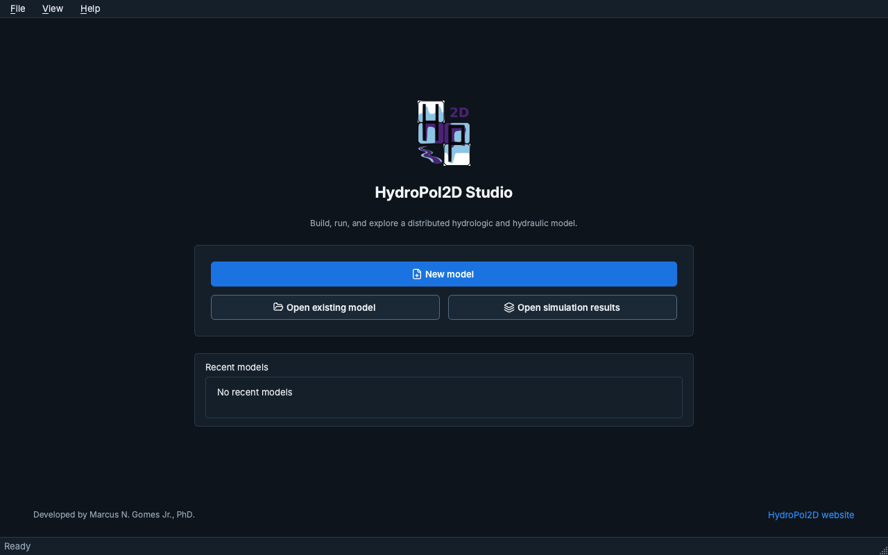

import useBaseUrl from '@docusaurus/useBaseUrl';

# HydroPol2D Studio

O HydroPol2D Studio é a interface desktop do HydroPol2D-Python. Ele monta um modelo a partir de um
mapa ou dos seus próprios arquivos, configura o modelo passo a passo, executa a simulação e mostra os
resultados. O Studio é uma camada separada em torno do motor do modelo: não chama o MATLAB e não
duplica o solver.

Esta seção descreve o Studio 0.9 (release candidate). A interface do Studio está em inglês, então os
nomes de botões, menus e mensagens aparecem aqui em inglês, como na tela.

  

  <em>Figura 1. O caminho pelo Studio 0.9. New model leva ao assistente, Open existing model ao Setup e Open simulation results ao Results; Cmd+1 a Cmd+4 alternam entre as quatro áreas de trabalho.</em>

## Instalar e iniciar {#install-and-start}

O Studio funciona com um código de licença dado por Marcus N. Gomes Jr. A página
[Instalação e licença](install-and-license) explica como pedir um código, instalar o Studio no Mac
ou no Windows e ativá-lo.

O app instalado abre como qualquer outro programa.

## Home {#home}

O Studio abre na tela **Home**, com três opções:

- **New model** abre o [assistente de novo modelo](building-a-model#new-model-wizard), que monta um
  modelo a partir de uma cidade, de um exutório de rio, de um arquivo de área ou do seu próprio
  terreno.
- **Open existing model** abre um `case.yaml` (ou uma planilha do formato antigo).
- **Open simulation results** abre um pacote de resultados sem um modelo.

Os modelos recentes aparecem abaixo das opções.

## Áreas de trabalho {#workspaces}

Um modelo tem quatro áreas de trabalho na barra à esquerda:

| Área de trabalho | Para que serve |
|---|---|
| **Setup** | Sete etapas: Model, Study area, Computational mesh, Processes, Parameters, Forcing e Review. |
| **Run** | Produtos de saída, a verificação das entradas, o backend de cálculo e a própria simulação, com diagnósticos ao vivo. |
| **Results** | Mapas e séries temporais de uma simulação concluída, com reprodução, perfis e exportação. |
| **Calibrate** | Séries observadas, os parâmetros a ajustar, as configurações da busca, a execução da calibração e os seus resultados. |

No Mac, Cmd+1 a Cmd+4 abrem cada uma delas (Ctrl+1 a Ctrl+4 no Windows).

## Nesta seção {#in-this-section}

- [Instalação e licença](install-and-license): como pedir a licença, instalar e ativar.
- [Montando um modelo](building-a-model): o assistente de novo modelo e as sete etapas do Setup.
- [Trabalhando no Studio](working-in-studio): como funcionam as edições, o Save e o Revert to saved,
  as mensagens de erro, os temas, os menus e os atalhos.
- [Execução e resultados](run-and-results): como executar um modelo e ler os resultados.
- [Calibração no Studio](calibrate): como ajustar parâmetros à vazão, às profundidades e às águas subterrâneas
  observadas.
